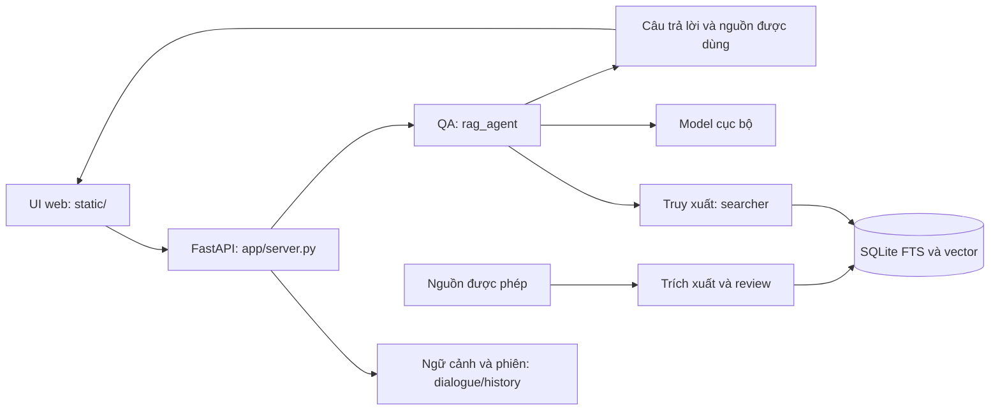

# Kiến trúc và cấu trúc Assistant-Team06

Cập nhật 16/10/2026 theo YC217. Sản phẩm là [QA học tập có nguồn](01_Y_TUONG_DU_AN.md).
Đối chiếu file hiện có trước khi sửa; bảng dưới không phải lệnh chuyển/đổi tên module.

## Kiến trúc đang chạy

| Phần hiện có | Vai trò và hợp đồng cần giữ |
| --- | --- |
| `app/server.py`, `run.py` | API, request validation, static routes và lệnh khởi động |
| `static/` | UI sản phẩm đang dùng: hỏi đáp, tra cứu, công cụ học, lịch ảnh |
| `app/rag_agent.py`, `answer_modes.py`, `reasoning_policy.py` | Điều phối trả lời và kiểm nguồn; không thay bằng chatbot không retrieval |
| `app/dialogue.py`, `history.py`, `token_counter.py` | Khóa hội thoại, phiên và ngân sách ngữ cảnh |
| `app/document_lookup.py`, `searcher.py` | Tra cứu/tìm kiếm và phạm vi tài liệu/trang |
| `app/pdf_extractor.py`, `text_cleaner.py`, `chunker.py`, `indexer.py` | Trích xuất, làm sạch, chia đoạn, chỉ mục |
| `app/source_page_reviews.py`, `source_quality.py`, `corpus_readiness.py` | Chất lượng và liên kết nguồn; không suy nguồn đúng từ số vector |
| `app/learning.py`, `practice.py` | Công cụ ôn tập/bài tập dựa trên nguồn |
| `app/timetable_*.py` | Tiện ích lịch ảnh, bản nháp và xác nhận trước lưu |
| `app/trained_client.py`, `ollama_client.py`, `mlx_infer.py`, `config.py` | Ranh giới runtime/model đã cấu hình |
| `scripts/dev.py`, launcher `.ps1`/`.command` | Demo/local và công cụ nền tảng |
| `tests/`, `tests/fixtures/` | Test tổng hợp dùng chung và các test riêng cần đầu vào rõ ràng |
| `.github/` | CI, mẫu issue và PR |
| `ui/` | Bản mẫu giao diện Lab 2; chưa phải UI chính |
| `corpus/README.md` | Quy ước nguồn riêng; không chứa thư viện thật |
| `docs/team/`, các README, DoD | Quy trình, đặc tả, hướng dẫn và nghiệm thu |

## Bài tập Lab 2 và điểm nối

Các component của issue là phân công trách nhiệm, không bắt buộc tạo một backend
thứ hai. Hiện chưa có implementation văn phòng/benchmark hoàn chỉnh ở main.

| Đầu ra issue | Cách tích hợp cần chốt trước triển khai |
| --- | --- |
| #18–19 UI mẫu/citation | Dùng schema backend hiện tại, ghi rõ mock; `static/` vẫn là UI demo sản phẩm |
| #20–21 lookup văn phòng/help | Logic xác định; kiểm không ảnh hưởng QA học tập và nguồn học thuật |
| #22–23 `data/offices.csv`, `data/README.md` | Ví dụ công khai, nguồn/người phụ trách/ngày cập nhật; ngoại lệ Git đúng hai file |
| #24–25 đặc tả AI và phân loại câu hỏi | Mô tả adapter cho runtime đang có; không coi hệ thống chưa có LLM |
| #26–27 `eval/cases.csv`, `eval/run.py` | Runner nhận đúng entrypoint đã chốt; thất bại trả exit code khác 0; báo từng ca |
| #28–29 secrets/review | Báo cáo phải thực sự có trong diff/clone, quét không công bố dữ liệu riêng |

Không tạo thư mục rỗng rồi coi component đã hoàn thành. Không commit `data/` toàn
bộ để đưa một CSV lên repo. Fixture đánh giá phần mềm công khai phải tách rõ với
dữ liệu huấn luyện giữ local theo YC214.

## Ranh giới vận hành

`src/` là nguồn riêng; `data/` là DB, vector, model, hội thoại/lịch và hồ sơ local.
Demo dùng nguồn tổng hợp, chỉ mục riêng. Không chuyển DB giữa máy rồi mặc định
đường dẫn còn đúng; không sửa PDF để làm review đạt. Chỉ một writer giữ corpus/
index/model chính. Các test không được chữa khóa hoặc ghi DB đang phục vụ.

Cấu hình/API có thể thay đổi: đọc `app/config.py`, `.env.example`, model request
trong `app/server.py` và OpenAPI `/docs`. Không dùng sơ đồ/table cũ thay source.
Đường dẫn nguồn trong corpus chuyển máy cần audit/migration có kiểm chứng riêng.
