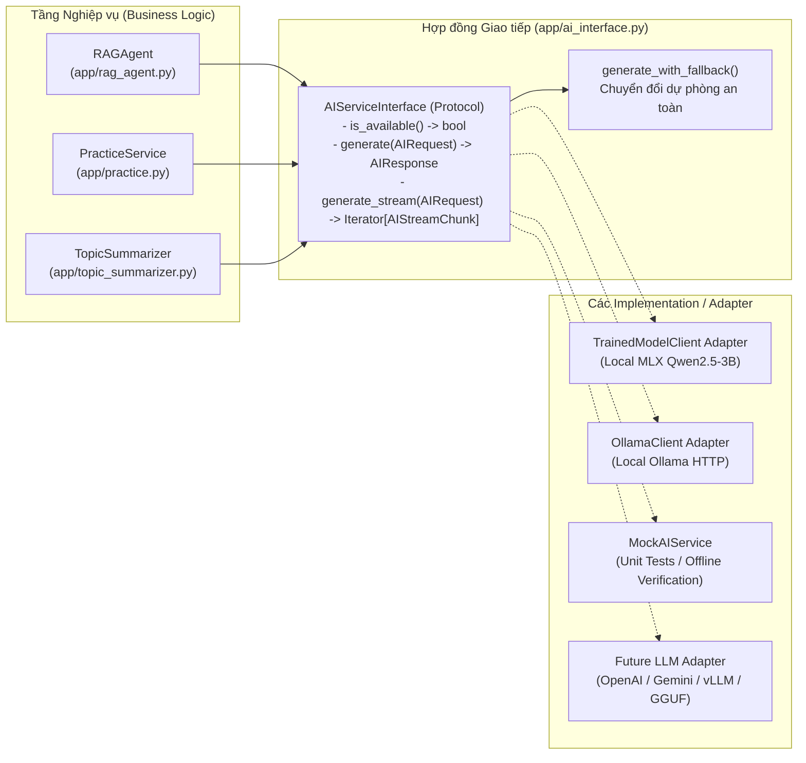

# Đặc tả Giao diện Dịch vụ AI (AI Service Interface for Future LLMs)

Tài liệu này định nghĩa hợp đồng giao tiếp (interface contract) chuẩn hóa giữa tầng nghiệp vụ của **Study Agent** và các bộ thực thi mô hình ngôn ngữ lớn (LLM implementations) hiện tại cũng như tương lai theo yêu cầu của **Issue #24** (`AI service: define the interface for the future LLM`).

> **Phạm vi Issue #24:** Chỉ định nghĩa hợp đồng giao tiếp (`function signature`, `inputs`, `outputs`, `errors`, `fallback`) và lớp kiểm thử giả lập (`MockAIService`). Chưa tích hợp hay gọi thêm nhà cung cấp LLM mới ngoài các runtime hiện hành của dự án.

---

## 1. Bối cảnh Kiến trúc & Phân tách Trách nhiệm (Interface Segregation)

Trong hệ thống hiện tại, các tác vụ liên quan đến AI được chia làm 3 nhóm năng lực độc lập:

1. **Sinh văn bản / Hội thoại (`AIServiceInterface` — Trọng tâm của tài liệu này):**
   - Được gọi bởi: [`app/rag_agent.py`](../app/rag_agent.py) (`PsychologyAgent` / `RAGAgent`), [`app/practice.py`](../app/practice.py), [`app/topic_summarizer.py`](../app/topic_summarizer.py), [`app/bilingual.py`](../app/bilingual.py), [`app/query_normalizer.py`](../app/query_normalizer.py).
   - Các runtime hiện có: [`OllamaClient`](../app/ollama_client.py) (HTTP REST tới Ollama cục bộ) và [`TrainedModelClient`](../app/trained_client.py) (subprocess MLX chạy `Qwen2.5-3B-Instruct-4bit` kèm LoRA adapter).
2. **Nhúng vector (`Embedding`):**
   - Được xử lý trực tiếp bởi [`HybridSearcher`](../app/searcher.py) thông qua `FlagEmbedding` (`BAAI/bge-m3`) để giữ không gian vector cố định.
3. **Thị giác máy tính / OCR Thời khóa biểu (`Vision OCR`):**
   - Được xử lý riêng trong [`app/timetable_vision.py`](../app/timetable_vision.py).

**Quyết định kiến trúc:** `AIServiceInterface` chỉ định nghĩa hợp đồng cho **Text Generation / Chat Completion**. Các phương thức tạo vector (`get_embedding`), OCR hình ảnh hoặc quản lý tiến trình đặc thù của từng nhà cung cấp (`unload_resident_models`, `list_models`) **không** nằm trong interface cốt lõi này để tránh ép các LLM tương lai phải cài đặt những hàm không liên quan.



---

## 2. Chữ ký hàm & Giao thức (`Function Signatures`)

Hợp đồng chuẩn được cài đặt tại [`app/ai_interface.py`](../app/ai_interface.py) thông qua `typing.Protocol` (`@runtime_checkable`) cùng hàm biên hỗ trợ fallback:

```python
from typing import Iterator, Optional, Protocol, runtime_checkable

@runtime_checkable
class AIServiceInterface(Protocol):
    """Hợp đồng chuẩn cho mọi dịch vụ sinh văn bản LLM."""

    def is_available(self) -> bool:
        """Kiểm tra nhanh xem provider/model có sẵn sàng nhận yêu cầu hay không (không ném exception)."""
        ...

    def generate(self, request: AIRequest) -> AIResponse:
        """Thực thi yêu cầu sinh văn bản đồng bộ.

        Raises:
            AIInvalidRequestError: Khi request vi phạm quy tắc đầu vào.
            AIConnectionError: Khi không kết nối được tới LLM runtime.
            AITimeoutError: Khi quá thời gian chờ phản hồi.
            AIProviderError: Khi runtime trả về lỗi nội bộ hoặc đầu ra hỏng.
        """
        ...

    def generate_stream(self, request: AIRequest) -> Iterator[AIStreamChunk]:
        """Thực thi yêu cầu sinh văn bản dạng luồng (streaming tokens).

        Raises:
            AIInvalidRequestError, AIConnectionError, AITimeoutError, AIProviderError
        """
        ...


def generate_with_fallback(
    request: AIRequest,
    primary: AIServiceInterface,
    *,
    secondary: Optional[AIServiceInterface] = None,
    fallback_content: str = "Hệ thống mô hình ngôn ngữ hiện chưa sẵn sàng. Vui lòng thử lại sau.",
) -> AIResponse:
    """Gọi dịch vụ AI thông qua interface với chuỗi dự phòng tự động."""
    ...
```

---

## 3. Đặc tả Đầu vào (`Inputs`)

Thay vì truyền rời rạc các tham số mang tên riêng của từng thư viện (`num_predict`, `num_ctx` của Ollama hay `max_tokens`, `seed` của MLX), đầu vào được chuẩn hóa thành 3 lớp dữ liệu bất biến (`@dataclass(frozen=True)`):

### 3.1. `ChatMessage`
| Trường | Kiểu dữ liệu | Bắt buộc | Mô tả |
|---|---|---|---|
| `role` | `Literal["system", "user", "assistant"]` | Có | Vai trò của tin nhắn trong hội thoại. |
| `content` | `str` | Có | Nội dung văn bản UTF-8 hợp lệ (không chứa surrogate/null bytes). |

### 3.2. `GenerationConfig`
| Trường | Kiểu dữ liệu | Mặc định | Ràng buộc hợp lệ & Ánh xạ |
|---|---|---|---|
| `max_tokens` | `int` | `512` | `> 0`. Adapter Ollama ánh xạ sang `options.num_predict`; Adapter MLX ánh xạ sang `max_tokens`. |
| `temperature` | `float` | `0.2` | `0.0 <= temperature <= 2.0`. |
| `context_window` | `int` | `4096` | `>= 256`. Adapter Ollama ánh xạ sang `options.num_ctx`. |
| `timeout_seconds` | `float` | `30.0` | `> 0.0`. Thời gian chờ tối đa cho mỗi lượt gọi. |
| `seed` | `Optional[int]` | `None` | Số nguyên dùng để tái lập kết quả khi provider hỗ trợ. |

### 3.3. `AIRequest`
| Trường | Kiểu dữ liệu | Mặc định | Quy tắc kiểm tra (`request.validate()`) |
|---|---|---|---|
| `messages` | `Sequence[ChatMessage]` | *(Bắt buộc)* | Phải có ít nhất 1 tin nhắn và có ít nhất 1 tin nhắn có `content.strip()` khác rỗng. |
| `system_prompt` | `Optional[str]` | `None` | Chỉ thị hệ thống cấp cao (nếu truyền riêng ngoài `messages`). |
| `config` | `GenerationConfig` | `GenerationConfig()` | Tự động kiểm tra toàn bộ ràng buộc của `GenerationConfig`. |
| `model` | `Optional[str]` | `None` | Tên model cụ thể nếu tầng điều phối chỉ định; nếu `None` thì dùng model mặc định của adapter. |

---

## 4. Đặc tả Đầu ra (`Outputs`)

Hiện tại, `OllamaClient` và `TrainedModelClient` trả về `str` trần và ghi trạng thái cắt cụt vào biến đối tượng `self.last_done_reason`, dễ gây xung đột trạng thái (race condition). Hợp đồng mới đóng gói kết quả và metadata vào cùng một đối tượng bất biến:

### 4.1. `AIResponse` (Kết quả đồng bộ)
| Trường | Kiểu dữ liệu | Mô tả |
|---|---|---|
| `content` | `str` | Văn bản câu trả lời hoàn chỉnh do mô hình sinh ra. |
| `finish_reason` | `Literal["stop", "length", "fallback", "error"]` | `"stop"`: hoàn tất tự nhiên; `"length"`: bị cắt do chạm ngưỡng `max_tokens`; `"fallback"`: trả về từ cơ chế dự phòng; `"error"`: dừng do lỗi. |
| `model` | `str` | Tên định danh mô hình thực tế đã xử lý yêu cầu. |
| `provider` | `str` | Định danh bộ thực thi (`"ollama"`, `"mlx_trained"`, `"mock"`, `"fallback"`). |
| `latency_ms` | `Optional[float]` | Thời gian thực thi tính bằng mili-giây (phục vụ quan sát/logging). |

**Thuộc tính tiện ích:** `response.is_truncated -> bool` trả về `True` khi `finish_reason == "length"`.

### 4.2. `AIStreamChunk` (Phần tử luồng streaming)
| Trường | Kiểu dữ liệu | Mô tả |
|---|---|---|
| `delta` | `str` | Đoạn văn bản (token) mới sinh thêm ở bước hiện tại. |
| `done` | `bool` | `True` nếu đây là gói tin kết thúc luồng. |
| `finish_reason` | `Optional[FinishReason]` | Được gán tại gói tin cuối (`done=True`), ví dụ `"stop"` hoặc `"length"`. |

---

## 5. Hợp đồng Lỗi (`Errors`)

Các bộ thực thi **không được** trả về thông báo lỗi dưới dạng văn bản thông thường (như chuỗi bắt đầu bằng `"❌"` hoặc `"Lỗi từ Ollama"`), mà phải ném ngoại lệ thuộc cây phân cấp `AIServiceError`:

| Lớp Ngoại lệ | Kế thừa từ | Tình huống kích hoạt | Hành động ở tầng gọi |
|---|---|---|---|
| `AIServiceError` | `Exception` | Lớp cơ sở cho mọi lỗi từ tầng AI service. | Bắt chung khi cần chuyển sang fallback. |
| `AIInvalidRequestError` | `AIServiceError` | `messages` rỗng, role không hợp lệ, `max_tokens <= 0`, `temperature` ngoài `[0.0, 2.0]`, hoặc chuỗi chứa ký tự điều khiển/surrogate không hợp lệ. | Không thử lại (non-retryable); trả lỗi kiểm tra đầu vào (HTTP 422). |
| `AIConnectionError` | `AIServiceError` | Không kết nối được tới máy chủ suy luận (Ollama chưa chạy, cổng đóng, môi trường `.train-venv` chưa cài). | Chuyển sang provider dự phòng hoặc trả về `fallback`. |
| `AITimeoutError` | `AIServiceError` | Thời gian suy luận vượt quá `config.timeout_seconds`. | Hủy lượt gọi hiện tại, chuyển sang dự phòng hoặc báo hệ thống bận. |
| `AIProviderError` | `AIServiceError` | Runtime trả về mã lỗi HTTP 4xx/5xx, tiến trình con thoát với mã khác 0, hoặc JSON phản hồi bị hỏng. | Ghi log kỹ thuật nội bộ (không lộ chi tiết nhạy cảm ra UI) và kích hoạt fallback. |

---

## 6. Cơ chế Dự phòng (`Fallback Policy`)

Khi một yêu cầu sinh văn bản gặp lỗi thuộc nhóm runtime (`AIConnectionError`, `AITimeoutError`, `AIProviderError`) hoặc `primary.is_available() == False`, hệ thống xử lý theo thứ tự ưu tiên sau:

1. **Bước 1 — Chuyển sang Provider thứ cấp (`secondary`):**
   - Ví dụ: Trên macOS, nếu `TrainedModelClient` (MLX) chưa sẵn sàng hoặc lỗi thực thi, hệ thống tự động chuyển sang `OllamaClient` cục bộ (tương đương hành vi của `RAGAgent._get_llm_client`).
2. **Bước 2 — Phản hồi dự phòng tất định (`Deterministic Fallback`):**
   - Nếu cả `primary` và `secondary` đều không khả dụng, hàm `generate_with_fallback` **không bịa đặt câu trả lời và không sinh trích dẫn giả**.
   - Hàm trả về đối tượng `AIResponse` hợp lệ với:
     - `content = fallback_content` (thông báo rõ trạng thái dịch vụ AI chưa sẵn sàng hoặc chỉ hiển thị nguyên văn kết quả tra cứu tài liệu nếu có).
     - `finish_reason = "fallback"`.
     - `provider = "fallback"`.
     - `model = "deterministic-fallback"`.
3. **Bước 3 — Lỗi đầu vào (`AIInvalidRequestError`):**
   - **Không** che giấu lỗi đầu vào bằng fallback; ngoại lệ `AIInvalidRequestError` luôn được ném thẳng để tầng gọi phát hiện lỗi lập trình hoặc từ chối request không hợp lệ.

---

## 7. Kiểm thử với Mock & Lưu ý khi Tích hợp LLM Tương lai

### 7.1. Kiểm thử không cần LLM thật (`MockAIService`)
Các unit test cho tầng nghiệp vụ sử dụng `MockAIService` (trong [`app/ai_interface.py`](../app/ai_interface.py)) để kiểm thử đầy đủ các kịch bản:
- Trả lời bình thường (`finish_reason="stop"`).
- Trả lời bị cắt cụt do giới hạn token (`finish_reason="length"`).
- Giả lập mất kết nối (`AIConnectionError`), quá hạn (`AITimeoutError`) hoặc lỗi provider (`AIProviderError`) để kiểm chứng nhánh `fallback`.

### 7.2. Những điểm cần lưu ý khi viết Adapter cho LLM tương lai
Khi tích hợp một nhà cung cấp mới (ví dụ OpenAI API, Google Gemini, Anthropic Claude hoặc vLLM), logic nghiệp vụ giữ nguyên, nhưng lớp Adapter mới cần đảm nhận:
- **Ánh xạ cấu trúc tin nhắn:** Chuyển `AIRequest.system_prompt` và `AIRequest.messages` sang định dạng riêng của từng SDK.
- **Chuẩn hóa `finish_reason`:** Ánh xạ mã kết thúc riêng của nhà cung cấp (ví dụ `MAX_TOKENS` của Gemini hay `max_tokens` của Anthropic) về đúng chuẩn `"stop"` hoặc `"length"`.
- **Chuyển đổi ngoại lệ:** Bắt các exception riêng của SDK/HTTP và bọc lại thành `AIConnectionError`, `AITimeoutError` hoặc `AIProviderError` để không rò rỉ chi tiết nội bộ ra tầng nghiệp vụ.
